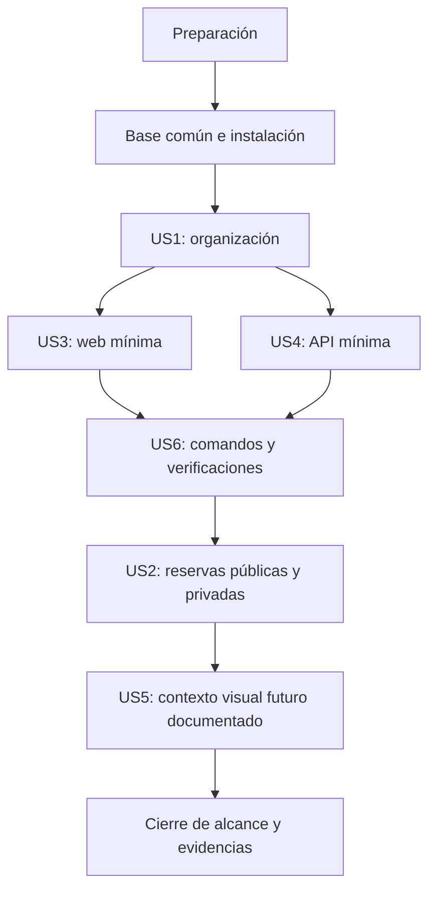

# Tasks: 001 - Inicialización del Monorepo y esqueleto técnico de la plataforma IMSS JSDP Sonora

**Input**: Documentos vigentes de `specs/001-inicializar-monorepo/`.

**Prerequisites**: [spec.md](spec.md), [plan.md](plan.md), [research.md](research.md),
[data-model.md](data-model.md), [quickstart.md](quickstart.md),
[contrato de salud](contracts/api-health.openapi.yaml) y
[Constitución 1.0.0](../../.specify/memory/constitution.md).

**Tests**: Las tareas incluyen las verificaciones manuales, tipos y compilación exigidas.
No se solicitan TDD, suites automatizadas ni frameworks adicionales de pruebas.

**Organization**: Seis historias, ordenadas por prioridad: US1, US3, US4 y US6 (P1);
US2 y US5 (P2). Se conservan sus identificadores originales.
Este archivo se genera durante Tasks; sus acciones se ejecutarán solo durante Implement.
Ninguna casilla marcada ni redacción del documento acredita una implementación realizada.

## Format: `[ID] [P?] [Story] Description`

- Cada tarea tiene casilla, identificador consecutivo, archivos y requisitos asociados.
- [P] permite ejecución simultánea solo al estar cumplidas las dependencias indicadas,
  con tareas que no compartan archivos, lockfile o procesos/puertos de verificación.
- Sin [P], ejecutar secuencialmente dentro de su rama de dependencias.
- [USn] identifica la historia de spec.md; preparación, base común y cierre no usan esa etiqueta.
- Los resultados de las comprobaciones se registran en el informe de Implement;
  no crear archivos de evidencias o código ficticio para completar casillas.

## Path Conventions

Raíz: package.json, package-lock.json, .gitignore y README.md.
Aplicaciones: apps/web y apps/api. Ubicaciones futuras: las tablas del plan.
Todas las rutas de tareas son relativas a la raíz; trabajar en la rama existente.
No inicializar Git, crear otra especificación o actualizar Node.js/npm.

## Phase 1: Setup (Shared Infrastructure)

**Purpose**: Comprobar el entorno instalado y preparar únicamente los archivos raíz necesarios.

- [ ] T001 Comprobar en Windows 11 que node --version devuelve v22.23.2 y npm --version devuelve 10.9.8; contrastar con specs/001-inicializar-monorepo/plan.md y research.md sin actualizarlos ni cambiar el equipo; registrar resultado y detenerse si el entorno difiere. [FR-015, FR-020]
- [ ] T002 [P] Crear package.json raíz privado con workspaces explícitos ["apps/web","apps/api"], engines node ">=22.23.2 <23" y npm ">=10.9.8 <11", y scripts dev:web, dev:api, build y typecheck exactamente según la tabla del plan; conservar el -- final de los scripts dev para reenviar argumentos, sin coordinador de procesos ni dependencias raíz. Depende de T001. [FR-001, FR-003, FR-014, FR-015]
- [ ] T003 [P] Crear .gitignore raíz para excluir node_modules en cualquier nivel, dist, archivos .env y variantes, logs y residuos de compilación; mantener versionable package-lock.json y, si se reserva, .env.example sin crear ese archivo ni secretos. Depende de T001. [FR-017, FR-018]

**Checkpoint**: Entorno seleccionado respetado y coordinación raíz definida.
T002 y T003 pueden realizarse simultáneamente después de T001.

## Phase 2: Foundational (Blocking Prerequisites)

**Purpose**: Definir propiedad de dependencias y completar la instalación común.
Esta fase no crea páginas, lógica de servidor ni código de funcionalidades futuras.

- [ ] T004 [P] Crear apps/web/package.json privado y ESM: dependencias react 19.3.1, react-dom 19.3.1, react-router 8.4.0 y zustand 5.0.15; desarrollo vite 8.3.4, @vitejs/plugin-react 6.1.2, tailwindcss y @tailwindcss/vite 4.3.3, typescript 7.0.2, @types/react 19.2.17, @types/react-dom 19.2.3 y @types/node 22.20.5; scripts dev="vite", build="tsc --noEmit && vite build", typecheck="tsc --noEmit". Son las referencias de research.md; verificar sus engines/peers sin sustituir bibliotecas o cambiar React Router silenciosamente. Depende de T002 y T003. [FR-001, FR-003, FR-014, FR-020]
- [ ] T005 [P] Crear apps/api/package.json privado y ESM con express 5.3.0, pg 8.23.1 y socket.io 4.8.4; desarrollo typescript 7.0.2, @types/express 5.0.6 y @types/node 22.20.5; scripts dev="node --watch src/server.ts", build="tsc -p tsconfig.json", typecheck="tsc -p tsconfig.json --noEmit" y start="node dist/server.js". Verificar engines/peers de las referencias de research.md sin añadir pg-native, tsx, ts-node o nodemon. Depende de T002 y T003. [FR-001, FR-003, FR-012, FR-014, FR-020]
- [ ] T006 Ejecutar npm install una vez desde la raíz con Node 22.23.2/npm 10.9.8 y generar el único package-lock.json; comprobar la resolución de ambos package.json, los engines/peers del árbol real y las dependencias opcionales de Windows sin --force, --legacy-peer-deps ni locks por aplicación; resolver cualquier incompatibilidad dentro del plan antes de continuar y comunicarla si requiere una decisión fuera de él. Depende de T004 y T005. [FR-003, FR-015, FR-016, FR-018]

**Checkpoint**: Instalación raíz válida sin iniciar PostgreSQL, Socket.IO o servicios
institucionales. No ejecutar scripts de aplicación hasta que existan sus entradas reales.

## Phase 3: User Story 1 - Monorepo organizado (Priority: P1)

**Goal**: Hacer identificable un único repositorio y dos aplicaciones con responsabilidades propias.

**Independent Test**: Revisar manifests e instalación desde la raíz; al existir las entradas
de US3/US4, comprobar arranque y compilación con la otra aplicación detenida.
La aceptación completa de US1 depende de esas entradas; no se crean stubs para adelantarla.

- [ ] T007 [US1] Crear README.md mínimo en español de México con contexto JSDP del OOAD Sonora del IMSS dentro del Gobierno de México y organización de apps/web, apps/api y docs; reservar packages/shared para contratos reales e infra para infraestructura futura solo mediante documentación, sin package.json, código o configuraciones vacías. Depende de T006. [FR-001, FR-002, FR-018, FR-021]
- [ ] T008 [US1] Inspeccionar package.json raíz, apps/web/package.json, apps/api/package.json, package-lock.json y README.md: confirmar exactamente dos workspaces, scripts propios, dependencias delimitadas, sin dependencias cruzadas/circulares ni repositorios adicionales; registrar la instalación T006 como evidencia y diferir la prueba de entradas a T014/T017. Depende de T007. [FR-001, FR-002, FR-003, FR-018, FR-022]

**Checkpoint**: Organización e instalación comprobadas; el arranque y build independientes
de US1 quedarán demostrados por US3 y US4, sin hacer depender web de la ejecución de api.

## Phase 4: User Story 3 - Página React mínima (Priority: P1)

**Goal**: Abrir solo / y obtener exactamente `
Hola IMSS
`, sin diseño ni Backend.

**Independent Test**: Con la API detenida, ejecutar desarrollo, tipos y build web;
inspeccionar el DOM y las solicitudes del navegador.

- [ ] T009 [P] [US3] Crear apps/web/tsconfig.json único para src y vite.config.ts con strict, noEmit, target ES2022, lib ES2022/DOM/DOM.Iterable, jsx react-jsx, module ESNext, moduleResolution Bundler, isolatedModules, verbatimModuleSyntax y types vite/client y node, sin aliases, referencias de proyecto o configuración compartida. Depende de T008. [FR-014, FR-018, FR-020]
- [ ] T010 [P] [US3] Crear apps/web/vite.config.ts con @vitejs/plugin-react y @tailwindcss/vite, server host 127.0.0.1, port 5173 y strictPort true; crear apps/web/src/styles/index.css únicamente con la importación técnica de tailwindcss, sin reglas propias, temas, PostCSS/Autoprefixer ni configuración Tailwind heredada. Depende de T008. [FR-008, FR-015, FR-018, FR-021]
- [ ] T011 [P] [US3] Crear apps/web/index.html mínimo con idioma es-MX, contenedor técnico y referencia a src/main.tsx; omitir logos, favicon, imágenes, recursos institucionales y cualquier plantilla visual o recurso de demostración. Depende de T008. [FR-007, FR-008, FR-018, FR-021]
- [ ] T012 [US3] Crear apps/web/src/app/router/index.tsx con React Router 8.4 en Declarative Mode usando BrowserRouter, Routes y una única Route exacta / cuyo elemento sea exclusivamente 
Hola IMSS
; no agregar wrappers visuales, clases, rutas futuras, comodines, redirects, páginas 404, loaders ni layouts. Depende de T009. [FR-004, FR-005, FR-006, FR-007, FR-008]
- [ ] T013 [US3] Crear apps/web/src/main.tsx para montar el router de T012 en el contenedor de index.html e importar src/styles/index.css, sin App redundante, stores, servicios, llamadas a api o páginas de ejemplo; no crear public/ ni copiar recursos de docs/identidad-institucional/. Depende de T010, T011 y T012. [FR-007, FR-008, FR-016, FR-018]
- [ ] T014 [US3] Ejecutar typecheck y build del workspace apps/web y npm run dev:web con la API detenida; comprobar en navegador que / contiene exactamente un p con "Hola IMSS", sin contenido adicional ni peticiones a api o recursos institucionales; verificar loopback, fallo por 5173 ocupado y cambio explícito mediante npm run dev:web -- --port 5174; detener procesos y registrar resultados conforme a specs/001-inicializar-monorepo/quickstart.md. Depende de T009 a T013. [FR-003, FR-007, FR-008, FR-014, FR-015, FR-016, FR-021, FR-022]

**Checkpoint**: Web ejecutable y compilable sin API; Zustand instalado sin utilizarlo.

## Phase 5: User Story 4 - Backend mínimo y ejecutable (Priority: P1)

**Goal**: Disponer de un proceso Express independiente y solo GET /api/health.

**Independent Test**: Con web detenida y sin base de datos ni credenciales, iniciar la API,
consultar el contrato de salud y repetir la comprobación sobre el artefacto compilado.

- [ ] T015 [P] [US4] Crear apps/api/tsconfig.json con strict, target ES2022, module y moduleResolution NodeNext, rootDir src, outDir dist, noEmitOnError, erasableSyntaxOnly, verbatimModuleSyntax, rewriteRelativeImportExtensions y types node; mantener desarrollo nativo de TypeScript en Node 22.23.2 sin herramientas adicionales. Depende de T008. [FR-014, FR-018, FR-020]
- [ ] T016 [US4] Crear apps/api/src/server.ts con configuración mínima de PORT (3000 por defecto; entero entre 1 y 65535), instancia Express y escucha exclusiva en 127.0.0.1; registrar únicamente GET /api/health con HTTP 200, application/json y objeto exacto {"status":"ok","service":"express"} según specs/001-inicializar-monorepo/contracts/api-health.openapi.yaml; ante puerto inválido u ocupado fallar con mensaje breve sin secretos/stack, sin importar o inicializar pg/Socket.IO ni añadir autenticación, capas ficticias, parsers, CORS o endpoints de negocio. Depende de T015. [FR-009, FR-010, FR-011, FR-012, FR-016, FR-018, FR-021]
- [ ] T017 [US4] Ejecutar typecheck/build del workspace apps/api y npm run dev:api con web detenida, sin credenciales ni PostgreSQL; consultar GET /api/health con Invoke-WebRequest y verificar status, Content-Type y las dos únicas claves del contrato; detener dev, ejecutar npm run start --workspace apps/api y repetir la consulta sobre dist/server.js; comprobar que /socket.io/ no negocia una sesión y no hay endpoints institucionales; detener procesos y registrar resultados según specs/001-inicializar-monorepo/quickstart.md. Depende de T016. [FR-003, FR-009, FR-010, FR-012, FR-014, FR-016, FR-022]
- [ ] T018 [US4] Verificar para apps/api/src/server.ts, sin modificarlo salvo corrección del comportamiento exigido, que PORT inválido/fuera de rango y puerto 3000 ocupado producen fallo sin éxito aparente; comprobar cambio local a PORT=3001 y GET /api/health, mantener escucha en loopback y retirar la variable de la sesión al finalizar, siguiendo specs/001-inicializar-monorepo/quickstart.md sin crear .env. Depende de T017. [FR-009, FR-015, FR-016, FR-021, FR-022]
- [ ] T019 [US4] Añadir a README.md el mapa conceptual apps/api/src/config, src/modules, src/middlewares, src/db y src/sockets del plan y su propósito futuro; aclarar que el archivo servidor actual no activa persistencia ni tiempo real y que no se crean módulos, clientes o middlewares vacíos para reservar esas ubicaciones. Depende de T018 y T007. [FR-011, FR-012, FR-018]

**Checkpoint**: API y artefacto compilado ejecutables sin web ni servicios; salud contractual veraz.

## Phase 6: User Story 6 - Entorno y verificaciones (Priority: P1)

**Goal**: Utilizar y comprobar la base en Windows 11 con los comandos del plan y sin actualizar el equipo.

**Independent Test**: Seguir el README desde la instalación limpia T006, reutilizar evidencia
independiente web/api y comprobar scripts agregados e ignorados. Sin repetir pruebas ya
satisfactorias salvo que haya cambios o fallos que lo justifiquen.

- [ ] T020 [US6] Completar README.md con prerrequisitos exactos Node 22.23.2/npm 10.9.8 en Windows 11, npm.cmd si PowerShell bloquea npm.ps1, instalación raíz, dev:web/dev:api en terminales independientes, build/typecheck raíz y por workspace, start local api, URLs, puertos alternativos y resolución de conflictos; explicar engines, ausencia de credenciales/servicios requeridos y no exponer los servidores a la red, sin instrucciones de actualización o producción. Depende de T014 y T019. [FR-003, FR-014, FR-015, FR-016, FR-021]
- [ ] T021 [P] [US6] Ejecutar npm run typecheck y npm run build desde package.json raíz con servidores detenidos; exigir código 0 para ambos workspaces y contrastar con las verificaciones individuales T014/T017, sin --if-present ni ocultar fallos; registrar evidencia contra specs/001-inicializar-monorepo/quickstart.md. Depende de T020. [FR-003, FR-014, FR-015, FR-022]
- [ ] T022 [P] [US6] Revisar .gitignore y archivos versionados mediante git ls-files, git status --short y git check-ignore --no-index sobre node_modules/example, apps/web/dist/example, .env y apps/api/.env.local, sin crear archivos de prueba; confirmar que package-lock.json es versionable y que dependencias, builds, credenciales reales y datos personales de prueba no están versionados. Depende de T020. [FR-017, FR-018, FR-022]

**Checkpoint**: Entorno y comandos reproducibles; el README se completa después con las
reservas de US2/US5, sin cambiar los comandos verificados.

## Phase 7: User Story 2 - Separación del Frontend público y privado (Priority: P2)

**Goal**: Crear la separación física principal public/private y documentar responsabilidades futuras sin implementar páginas o acceso privado.

**Independent Test**: Inspeccionar las dos carpetas principales, su contenido permitido,
el mapa de arquitectura y el router; probar URLs futuras sin obtener contenido de aplicación.
No requiere implementar autenticación o una página de error.

- [ ] T023 [US2] Crear físicamente apps/web/src/features/public/ y apps/web/src/features/private/; si están vacías, permitir un .gitkeep en cada una para conservarlas en Git, sin componentes React, layouts, stores ni archivos TypeScript vacíos dentro de ellas; no crear todavía landing, documents, auth o dashboard y añadir a README.md el mapa conceptual apps/web/src/features/public/landing, public/documents, public/auth, private/dashboard y módulos privados futuros, además de src/components, src/layouts, src/hooks, src/stores y src/services; distinguir el uso actual de src/app/router y src/styles de las reservas, los layouts independientes futuros y /documentos, /inicio-sesion y /app/* no habilitadas; explicar público dentro de intranet y protección futura efectiva en Backend, manteniendo las subcarpetas futuras solo como reservas documentadas y admitiendo únicamente los dos .gitkeep organizativos si hacen falta. Depende de T020, T021 y T022. [FR-004, FR-005, FR-006, FR-018, FR-021]
- [ ] T024 [US2] Con apps/web/src/app/router/index.tsx sin nuevas rutas, abrir directamente /documentos, /inicio-sesion, /app/ y una URL desconocida en el servidor web; verificar cero contenido de aplicación, redirecciones, saludo reutilizado o pantallas 404; revisar la separación documentada en README.md, la existencia física de public/ y private/ y que solo contengan sus .gitkeep opcionales, sin subcarpetas futuras ni código; constatar que solo / sigue habilitada, sin exigir HTTP 404 al fallback de Vite; detener el proceso. Depende de T023 y T014. [FR-004, FR-005, FR-006, FR-022]

**Checkpoint**: Carpetas principales public/private físicas, subcarpetas solo previstas y ninguna experiencia futura implementada.

## Phase 8: User Story 5 - Contexto futuro de Impeccable (Priority: P2)

**Goal**: Preservar ubicaciones futuras y un contexto compartido dentro del único Frontend.

**Independent Test**: Revisar la documentación y comprobar la ausencia de archivos visuales
y comandos de Impeccable, sin crear carpetas obligatorias para la herramienta.

- [ ] T025 [US5] Añadir a README.md las ubicaciones futuras apps/web/PRODUCT.md, apps/web/DESIGN.md y apps/web/.impeccable/surfaces/ con un único contexto de producto, sistema visual compartido y briefs diferentes para Landing, Documentos, Login y Dashboard; aclarar que no se divide el Frontend, no hay documentos por página ni carga automática supuesta, sin crear esos archivos o ejecutar Impeccable. Depende de T024. [FR-013, FR-018]
- [ ] T026 [US5] Contrastar README.md con el árbol apps/web para confirmar que no existen PRODUCT.md, DESIGN.md, surface briefs, layouts o componentes visuales de ejemplo y que las reservas no han creado subcarpetas landing/documents/auth/dashboard ni archivos vacíos de código; permitir exclusivamente apps/web/src/features/public/.gitkeep y apps/web/src/features/private/.gitkeep si mantienen vacías esas carpetas, sin marcadores de Impeccable; registrar la comprobación de US5 sin generar documentos nuevos. Depende de T025. [FR-005, FR-008, FR-013, FR-018, FR-019, FR-022]

**Checkpoint**: Contexto visual solo previsto; no se diseñó ninguna interfaz.

## Phase 9: Polish & Cross-Cutting Concerns

**Purpose**: Cerrar la entrega comprobando límites y reuniendo la evidencia existente.

- [ ] T027 Revisar los archivos finales package.json, package-lock.json, .gitignore, README.md y apps/ contra specs/001-inicializar-monorepo/plan.md: justificar cada archivo, comprobar la existencia física de apps/web/src/features/public/ y apps/web/src/features/private/ y admitir sus .gitkeep como marcadores organizativos si están vacías, sin subcarpetas futuras; mantener ausencia de código de relleno, rutas/vistas futuras, auth, stores, conexiones pg, migraciones, eventos Socket.IO, Docker, CI/CD o producción; verificar que docs/identidad-institucional/ conserva sus cuatro archivos originales y no tiene copias en recursos web; no modificar Constitución, Spec ni artefactos de diseño para acomodar desviaciones. Depende de T021, T022, T024 y T026. [FR-005, FR-008, FR-012, FR-013, FR-017, FR-018, FR-019, FR-020, FR-021]
- [ ] T028 Consolidar en el informe de Implement la evidencia de instalación T006, web T014/T024, API T017/T018, tipos/build T021 e ignorados/alcance T022/T027; contrastar los ocho SC de specs/001-inicializar-monorepo/spec.md y actualizar las casillas de specs/001-inicializar-monorepo/tasks.md solo para tareas realmente completadas, sin crear archivos de resultados ni repetir comprobaciones satisfactorias sin motivo; no declarar entrega completa si queda algún fallo. Depende de T027. [FR-022, SC-001, SC-002, SC-003, SC-004, SC-005, SC-006, SC-007, SC-008]

## Dependencies & Execution Order

### Phase Dependencies

1. T001 valida el entorno; T002 y T003 pueden avanzar juntos.
2. T004/T005 pueden avanzar juntos después de la fase 1; T006 requiere ambos manifests.
3. US1 completa la documentación base e inspección (T007 → T008).
4. Tras T008, web y api pueden desarrollarse sin depender de la ejecución de la otra.
   El orden secuencial por defecto es US3 y luego US4, conservando prioridades P1.
5. US6 consolida comandos y validaciones al terminar US3 y US4.
6. US2 crea las dos carpetas principales; US2 y US5 completan reservas documentales y
   verificaciones P2 en secuencia porque ambas editan README.md. No crear ni esperar
   sus subcarpetas o páginas futuras para considerar estas historias.
7. El cierre exige todas las comprobaciones anteriores.

### User Story Dependencies

| Historia | Tareas | Prerrequisitos | Comprobación de aceptación |
| --- | --- | --- | --- |
| US1 (P1) | T007–T008 | T001–T006 | Organización/instalación; arranque/build independientes se evidencian después con US3/US4 |
| US3 (P1) | T009–T014 | Base y T008 | Saludo y DOM exactos en /, web sola, tipos/build, puertos |
| US4 (P1) | T015–T019 | Base y T008; escritura de README después de T007 | Salud contractual y API compilada, sin web/DB, puertos inválidos/ocupados |
| US6 (P1) | T020–T022 | US3 y US4 | README reproducible, scripts agregados, exclusión de dependencias/secretos |
| US2 (P2) | T023–T024 | US6 y web mínima | Carpetas public/private físicas, mapa de reservas y ninguna vista en URLs futuras |
| US5 (P2) | T025–T026 | US2 por escritura compartida en README | Ubicaciones visuales documentadas y ausencia de sus archivos |

La dependencia de US2/US5 es de edición documental, no de funcionalidad de negocio.
La dependencia de US1 respecto de las entradas es de aceptación final: no bloquea su
creación ni justifica construirlas dos veces. No se exige que US6 espere diseños futuros.

### Within Each User Story

Las dependencias explícitas de cada tarea prevalecen sobre el mero orden numérico.
No crear modelos o servicios: data-model.md declara que no existen entidades.
No crear suites de prueba ni generar código desde OpenAPI; la API se contrasta por HTTP.
Instalar paquetes y modificar lockfile se hace de forma secuencial en T006.
Para verificaciones locales, reservar el puerto y detener procesos antes de reutilizarlo.

### Parallel Opportunities

Diez tareas marcadas [P]: T002, T003, T004, T005, T009, T010, T011, T015, T021 y T022.
La marca no elimina sus prerrequisitos ni autoriza editar un mismo archivo simultáneamente.

| Grupo | Momento habilitado | Motivo por el que no hay conflicto |
| --- | --- | --- |
| T002 + T003 | Tras T001 | package.json y .gitignore distintos |
| T004 + T005 | Tras T002/T003 | Manifests de aplicaciones diferentes; no instalar todavía |
| T009 + T010 + T011 | Tras T008 | Configuración TS, integración Vite/CSS y documento HTML distintos |
| T015 junto al grupo web | Tras T008 | Configuración TS api separada de web; api no necesita esperar T014 |
| T021 + T022 | Tras T020 | Build/tipos escriben dist; revisión de ignorados no modifica archivos ni depende de dist existente |

## Parallel Example: User Story 1

T007 y T008 se realizan secuencialmente: la inspección lee el README que acaba de crearse.
No hay paralelismo interno seguro que requiera marcar estas tareas.
La instalación común T006 ya finalizó antes de empezar.

## Parallel Example: User Story 3

Tras T008, preparar en paralelo T009 (apps/web/tsconfig.json), T010
(apps/web/vite.config.ts y src/styles/index.css) y T011 (apps/web/index.html).
T012 sigue a T009; T013 espera T010/T011/T012; T014 verifica el resultado completo.

## Parallel Example: User Story 4

T015 puede ejecutarse mientras se preparan T009/T010/T011 porque trabaja en apps/api.
Después, T016, T017, T018 y T019 avanzan en secuencia. No paralelizar verificaciones que
compitan por el mismo puerto ni la escritura de README.md con otras historias documentales.

## Parallel Example: User Story 6

Tras T020, ejecutar T021 y T022 en paralelo: una tarea ejecuta los agregados de npm
y otra valida reglas Git con rutas hipotéticas, sin crear ni leer artefactos incompletos.

## Parallel Example: User Story 2

T023 y T024 son secuenciales: primero se crean las dos carpetas principales y se documentan
las reservas; después se contrastan la estructura física y el comportamiento real. No hay tareas paralelizables internas ni se crea una página futura.

## Parallel Example: User Story 5

T025 y T026 son secuenciales y comparten lectura/escritura del README. No ejecutarlas
en paralelo con T023. La verificación de ausencia no crea un archivo de Impeccable.

## Implementation Strategy

### MVP First

Preparación y base común → organización US1 → página mínima US3 y salud US4 → comandos
y verificaciones US6. Este es el primer corte ejecutable; US1 por sí sola aporta estructura,
pero no satisface la aceptación de arranque/build sin las entradas de US3/US4.
Completar US2/US5 y el cierre para declarar terminada la Spec 001; ninguna historia se omite.
No desplegar ni diseñar interfaces como parte de este corte.

### Incremental Delivery

Validar cada historia con su comprobación independiente y conservar la evidencia para
T028. Solo las carpetas principales public/private se crean físicamente, con .gitkeep
permitido si están vacías. Sus subcarpetas futuras y las reservas de Impeccable se incorporan
solo a README, sin convertirse en código, navegación, layouts, modelos o documentos visuales.
No ampliar las versiones elegidas ni actualizar Node/npm para resolver incidencias.

### Traceability

| Requisitos | Tareas que los implementan o verifican |
| --- | --- |
| FR-001, FR-002 | T002, T004, T005, T007, T008 |
| FR-003 | T002, T004–T006, T008, T014, T017, T020, T021 |
| FR-004, FR-005, FR-006 | T012, T023, T024, T026, T027 |
| FR-007, FR-008 | T010–T014, T026, T027 |
| FR-009, FR-010 | T016, T017, T018 |
| FR-011, FR-012 | T016–T019, T027 |
| FR-013 | T025, T026, T027 |
| FR-014, FR-015, FR-016 | T001, T002, T004–T006, T009, T010, T013–T018, T020, T021 |
| FR-017, FR-018 | T003, T006–T011, T013, T015, T016, T019, T022, T023, T025–T027 |
| FR-019, FR-020, FR-021 | T001, T004, T005, T007, T009–T011, T015, T016, T018, T020, T023, T026, T027 |
| FR-022 y SC-001 a SC-008 | T008, T014, T017, T018, T021, T022, T024, T026–T028 |

## Notes

28 tareas: preparación 3, base común 3, US1 2, US3 6, US4 5, US6 3, US2 2, US5 2 y cierre 2.
Toda verificación aquí es trabajo futuro; este comando genera únicamente tasks.md.
Los marcadores del checklist de calidad de requisitos no se modifican durante Implement.
No se crea una nueva rama, especificación, archivo de diseño ni funcionalidad fuera de alcance.
