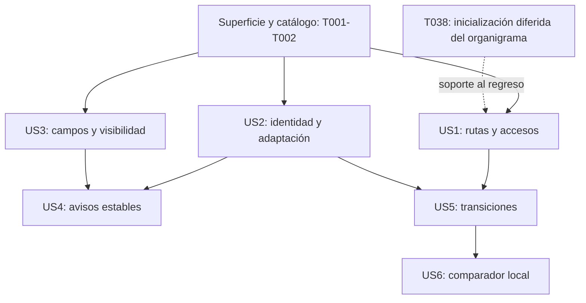

# Tasks: 003 — Interfaz de inicio de sesión de JSDP Sonora

**Tipo**: Registro retrospectivo del trabajo de interfaz ya implementado con Impeccable.

**Input**: [spec.md](spec.md), [plan.md](plan.md), [research.md](research.md), [data-model.md](data-model.md), [contrato de interfaz](contracts/interfaz-login.md), [contrato del selector local](contracts/selector-animacion-local.md), [quickstart.md](quickstart.md) y archivos actuales citados por tarea.

**Carpeta documental**: `specs/003-inicio-sesion-as-built/`

**Fecha documental**: 2026-11-04

**Rama de procedencia**: `003-inicio-sesion-02`, según los documentos de referencia; esta fase no consulta ni ejecuta acciones de Git.

**Commit de referencia**: `bfc70c5a75ff7f779e234964b903ecc47812c04b` — «Implementa login JSDP y selector de animaciones», conforme a la referencia registrada en spec y plan.

**Estado**: 38 tareas documentadas, 38 completas y 0 pendientes dentro del alcance de interfaz implementado.

**Cierre de coherencia documental**: 2026-11-04. Se conserva el recuento tras contrastar las tareas con spec, plan, auxiliares y fuentes actuales, sin ejecutar sus escenarios de validación.

`[x]` significa que el trabajo descrito está presente y respaldado por los archivos citados; no acredita por sí solo pruebas ejecutadas, funcionamiento integral ni aprobación institucional.

El documento registra presencia y lógica de implementación mediante lectura estática. No es una orden para volver a implementar, ejecutar verificaciones, guardar elecciones, generar issues o publicar la interfaz. El orden de fases y tareas es documental, no una reconstrucción de fechas, autores, commits intermedios o paralelismo histórico.

## Format: `[ID] [Story] Description`

- Todas las tareas comienzan con `- [x]` por petición expresa del usuario para esta reconstrucción retrospectiva, en lugar de la casilla vacía de la plantilla ordinaria.
- Los identificadores T001 a T038 son secuenciales. Las tareas de historias llevan su etiqueta US1 a US6; fundamentos y aspectos transversales no requieren etiqueta de historia.
- Cada tarea indica rutas relativas a la raíz del repositorio, evidencia localizable y requisitos relacionados. Las rutas se escriben completas para evitar ambigüedades entre archivos de igual nombre.
- Las prioridades corresponden a la spec: US1–US4 son P1 y US5–US6 son P2. No se infiere de ellas una prioridad histórica de implementación.
- Los criterios independientes de cada fase son pautas documentadas de correspondencia; no se presentan como pruebas ejecutadas o tareas adicionales completadas.
- No se asigna un marcador de paralelismo: no hay trabajo pendiente que distribuir y varias historias comparten archivos.

## Path Conventions

El producto pertenece a `apps/web/`. Las referencias de diseño bajo `output/` y los materiales históricos bajo `tmp/` no son pantallas adicionales de producción. La documentación de esta entrega se limita a `specs/003-inicio-sesion-as-built/`.

La captura del formulario es temporal; no se reconstruyen entidades de usuarios persistidos, tablas, sesiones, tokens o servicios de autenticación. Los únicos datos guardados por la herramienta de elección corresponden a un perfil de animación del proyecto.

## Phase 1: Setup — antecedentes de la base compartida

La inicialización del monorepo, configuración inicial de React/TypeScript/Vite, fuente global y desarrollo anterior de la landing son antecedentes documentados en las [Specs 001](../001-inicializar-monorepo/spec.md) y [002](../002-landing-principal-as-built/spec.md). No se repiten aquí como tareas nuevas ni se atribuyen al login.

No hay tareas de instalación, inicialización Git, creación de aplicaciones, migraciones o configuración vacía para llenar esta fase. Las versiones declaradas y el modo estricto se registran en el contexto técnico de `plan.md`; su presencia no acredita ejecución de tipos o compilación en esta fase.

## Phase 2: Foundational — soporte de la superficie y del movimiento

**Propósito retrospectivo**: localizar la organización compartida que utilizan las historias, sin duplicar los comportamientos específicos registrados después.

- [x] T001 Organizada la superficie pública de acceso con componente y estilos propios en `apps/web/src/features/public/auth/LoginPage.tsx` y `apps/web/src/features/public/auth/LoginPage.css`. **Evidencia**: exportación de `LoginPage`, importación de `./LoginPage.css` y raíz `main.login-page` con marco, tarjeta, zona visual y acceso. **Trazabilidad**: base de US1–US4 y FR-001, FR-003 a FR-014; la declaración de ruta se registra en T003.
- [x] T002 Incorporado el catálogo compartido de movimiento en `apps/web/src/app/router/motion.ts`. **Evidencia**: `motionProfiles` define los cinco IDs `soft`, `depth`, `slide`, `layers`, `curtain`, con nombre, descripción y duración; `MotionProfile` deriva del catálogo e `isMotionProfile` comprueba pertenencia. **Trazabilidad**: base de US5/US6, FR-016 y FR-020; la reproducción y selección efectiva se registran en sus historias.

**Checkpoint documental**: la superficie y el catálogo están localizados. No se acredita una nueva preparación de entorno ni un framework de autenticación.

## Phase 3: User Story 1 — Llegar al login y regresar al inicio (Priority: P1)

**Goal**: acceder al login desde la experiencia pública y regresar sin disponer de una cuenta habilitada.

**Independent Test — criterio documentado, no ejecutado**: contrastar los dos enlaces de la landing, la ruta y título del login, el retorno explícito y la orientación de foco/scroll durante navegación interna. Corresponde a SC-001 y los escenarios de US1.

- [x] T003 [US1] Declarada la ruta pública `/inicio-sesion` en `apps/web/src/app/router/index.tsx`. **Evidencia**: importación de `LoginPage` y `Route path="/inicio-sesion"` dentro de `Routes location={rendered}`, junto a la ruta existente `/`; no se exige una sesión previa para mostrarla. **Trazabilidad**: US1, FR-001.
- [x] T004 [US1] Habilitado el acceso del encabezado en `apps/web/src/features/public/landing/LandingPage.tsx`. **Evidencia**: `Header` presenta `Link to="/inicio-sesion"` con «Iniciar sesión», icono y clases `header-action header-action-login`; el grupo se nombra «Accesos». **Trazabilidad**: US1, FR-001; no se atribuye aquí el resto del encabezado histórico.
- [x] T005 [US1] Habilitado el acceso del pie en `apps/web/src/features/public/landing/LandingFooter.tsx`. **Evidencia**: grupo JSDP Sonora con «Inicio de sesión» y `href: '/inicio-sesion'`; la rama para destinos que empiezan con `/` utiliza `Link`, mientras los enlaces externos conservan su tratamiento propio. **Trazabilidad**: US1, FR-001.
- [x] T006 [US1] Incorporados retorno y título de pantalla en `apps/web/src/features/public/auth/LoginPage.tsx`. **Evidencia**: `Link to="/"` con «Volver al inicio» y efecto que establece `document.title = 'Inicio de sesión | JSDP Sonora'`. **Trazabilidad**: US1, FR-002.
- [x] T007 [US1] Coordinados foco y desplazamiento en navegación interna ordinaria en `apps/web/src/app/router/index.tsx`. **Evidencia**: `scrollPositions` guarda `window.scrollY` por clave; `POP` recupera el valor o 0 y navegación nueva utiliza 0; `commit` llama a `window.scrollTo` instantáneo y enfoca `main` con `preventScroll`; el efecto establece restauración manual del historial y restituye su valor anterior al desmontar. **Trazabilidad**: US1, FR-015. **Límite**: es memoria de la visita; el catch excepcional no repite todos los efectos de `commit`.

**Checkpoint documental**: los puntos de entrada, retorno y coordinación ordinaria están presentes; no se afirma soporte de una URL directa en cualquier servidor de producción.

## Phase 4: User Story 2 — Reconocer la institución en una tarjeta adaptable (Priority: P1)

**Goal**: identificar el ámbito institucional y disponer de una composición amplia o apilada según el espacio disponible.

**Independent Test — criterio documentado, no ejecutado**: observar marcas, fotografía, fondo/sombra, proporciones, centrado independiente del retorno y adaptación en las ocho ventanas de SC-002, incluyendo el scroll permitido. No se acredita una medición nueva de esas ventanas.

- [x] T008 [US2] Compuesto el bloque visual con la escultura y formas orgánicas en `apps/web/src/features/public/auth/LoginPage.tsx`, `apps/web/src/features/public/auth/LoginPage.css` y `apps/web/public/identity/Escultura_IMSS.webp`. **Evidencia**: `login-visual`, firma «IMSS / SONORA», `login-photo` con imagen de la escultura y lema «Cerca de nuestra gente.»; pseudo-elementos decorativos, recorte orgánico, rotación del marco y contrarrotación de la imagen con `object-fit: cover`. **Trazabilidad**: US2, FR-003, FR-004.
- [x] T009 [US2] Integradas las tres marcas y sus descripciones en `apps/web/src/features/public/auth/LoginPage.tsx`, con recursos `apps/web/public/identity/JSDP-Sonora-11.svg`, `apps/web/public/identity/Gobierno_de_Mexico_2024-2030.svg` y `apps/web/public/identity/Logotipo_del_IMSS.svg`. **Evidencia**: `login-brand`, `login-government` y `login-imss` referencian los archivos y declaran `alt`; `login-footer` presenta «OOAD Sonora · Desarrollo de Personal» y separador ornamental. **Trazabilidad**: US2, FR-003 y parte descriptiva de FR-014; no acredita autorización de convivencia de marcas.
- [x] T010 [US2] Aplicados fondo gris, tarjeta blanca, sombra y paleta local en `apps/web/src/features/public/auth/LoginPage.css`. **Evidencia**: `.login-page` usa `#eef0f2`; `.login-card` usa blanco, radio 24 px y sombra `0 24px 48px -12px #00000040, 0 4px 8px #00000026`; las variables de texto y acento conservan la paleta construida. **Trazabilidad**: US2, FR-004; valores observados, sin adopción institucional definitiva.
- [x] T011 [US2] Recuperadas proporciones amplias y centrado de escritorio independiente del regreso en `apps/web/src/features/public/auth/LoginPage.css`. **Evidencia**: marco `width: min(100%, 1160px)`; desde 761 px altura `min(calc(100% - 50px), 792px)` y tarjeta al 100% con columnas 43/57; página en cuadrícula centrada; enlace absoluto con `bottom: calc(100% + 4px)`, altura mínima 32 px y texto 13 px. **Trazabilidad**: US2, FR-004 y FR-005; son límites adaptables, no dimensiones fijas para toda pantalla.
- [x] T012 [US2] Ajustada la composición de escritorio a la altura disponible en `apps/web/src/features/public/auth/LoginPage.css`. **Evidencia**: `100svh`/`100dvh`, `min-height: 0`, acceso con `overflow-y: auto` y bloques sin encogimiento; media queries de altura hasta 800 y 660 px reducen espaciado, marcas y campos. **Trazabilidad**: US2, FR-005; el scroll interno sigue permitido si el contenido no cabe.
- [x] T013 [US2] Incorporadas reglas de ajuste horizontal y tamaños base del contenido en `apps/web/src/features/public/auth/LoginPage.css`. **Evidencia**: `min-width: 0`, columnas `minmax(0, ...)`, formulario de hasta 380 px, marca base de 200 px y campos de ancho completo; hasta 1100 px se reducen paddings y las opciones admiten envoltura. **Trazabilidad**: US2, FR-004 y FR-006. **Límite**: la ausencia de desbordamiento en la matriz de SC-002 no se mide en esta fase.
- [x] T014 [US2] Incorporada distribución móvil en `apps/web/src/features/public/auth/LoginPage.css`. **Evidencia**: hasta 760 px el marco se limita a 520 px, la tarjeta usa columna, acceso con `order: 1` e imagen con `order: 2`, radio 16 px, campos con texto 16 px, bloque visual de al menos 400 px y fotografía de 210×260 px; se oculta `login-visual-signature`. **Trazabilidad**: US2, FR-003 y FR-006. **Límite**: se admite scroll vertical de página y el orden del documento no se reescribe mediante el orden visual.

**Checkpoint documental**: la composición y las reglas adaptables están presentes. El ancho mínimo global de 320 px es antecedente compartido, no una tarea nueva del login; no se garantiza ausencia de scroll en alturas, zoom o anchos arbitrarios.

## Phase 5: User Story 3 — Introducir datos y controlar la visibilidad de la contraseña (Priority: P1)

**Goal**: identificar los campos, capturar datos temporales y controlar la visibilidad de contraseña sin una autenticación operativa.

**Independent Test — criterio documentado, no ejecutado**: contrastar etiquetas/ayudas, iconos y foco visible; usar valores ficticios y alternar dos veces la contraseña conservando el valor; observar el recordatorio deshabilitado. Corresponde a SC-003 y a la parte de visibilidad de SC-004.

- [x] T015 [US3] Incorporados los campos no controlados y sus etiquetas/ayudas en `apps/web/src/features/public/auth/LoginPage.tsx`. **Evidencia**: pares `htmlFor/id` para matrícula y contraseña, nombres `matricula`/`password`, placeholders e introducción «Ingresa con tu matrícula y contraseña.», sin `value/onChange` de credenciales. **Restricciones del modelo**: «`inputMode="numeric"` sugiere teclado; no impone números, longitud, patrón u obligatoriedad. `autoComplete="off"`.»; para contraseña: «Sin mínimo, patrón, obligatoriedad o comprobación de credenciales; `autoComplete="off"`.». **Trazabilidad**: US3, FR-007 y FR-014; se describe ausencia de validación propia, no validación implementada.
- [x] T016 [US3] Incorporados iconos internos y reglas de foco de controles en `apps/web/src/features/public/auth/LoginPage.tsx` y `apps/web/src/features/public/auth/LoginPage.css`. **Evidencia**: `FieldIcon` dibuja persona/candado de 20×20 px con `aria-hidden`; `.login-field-icon` centra el SVG a 16 px del borde, sin capturar eventos; inputs reservan 46 px a la izquierda y el de contraseña 52 px a la derecha; `:focus-visible` añade contorno de 3 px. **Trazabilidad**: US3, FR-007 y FR-014.
- [x] T017 [US3] Incorporada alternancia de visibilidad sin envío en `apps/web/src/features/public/auth/LoginPage.tsx` y `apps/web/src/features/public/auth/LoginPage.css`. **Evidencia**: `showPassword` inicia en falso, botón `type="button"` invierte ese estado y alterna el tipo del mismo input, nombre «Mostrar contraseña»/«Ocultar contraseña» y `aria-pressed`; `.login-reveal` tiene caja de 44×44 px. **Trazabilidad**: US3, FR-008 y parte de FR-014; no se guarda un estado de credenciales ni se navega al alternar.
- [x] T018 [US3] Presentado el recordatorio todavía deshabilitado en `apps/web/src/features/public/auth/LoginPage.tsx`. **Evidencia**: etiqueta «Recordar matrícula», checkbox `disabled`, sin selección inicial configurada y título «Disponible cuando se habilite el acceso». **Restricción del modelo**: «El usuario no lo cambia mediante la interfaz ordinaria.». **Trazabilidad**: US3, FR-009; la tarea acredita su presentación deshabilitada, no un mecanismo de persistencia.

**Checkpoint documental**: campos, iconos, visibilidad y estado deshabilitado existen; no se atribuye validación de identidad, almacenamiento de matrícula o control completo de las ayudas del navegador.

## Phase 6: User Story 4 — Entender las acciones aún no habilitadas sin saltos de distribución (Priority: P1)

**Goal**: informar que acceso, recuperación y solicitud aún no están habilitados, reutilizando una región estable del formulario.

**Independent Test — criterio documentado, no ejecutado**: cotejar el aviso inicial y los tres avisos de acción, la sustitución de mensajes y el criterio de estabilidad de SC-004, sin realizar autenticación. Las tolerancias geométricas no se convierten en una tarea de medición completada.

- [x] T019 [US4] Incorporada la región de estado inicial y su asociación accesible en `apps/web/src/features/public/auth/LoginPage.tsx`. **Evidencia**: `notice` inicia vacío; `login-notice` presenta «El acceso al sistema se habilitará próximamente.» mediante alternativa de texto, `role="status"`, `aria-live="polite"`, `aria-atomic="true"` y asociación del formulario por `aria-describedby`; `data-active` deriva del aviso vigente. **Trazabilidad**: US4, FR-010 y FR-013.
- [x] T020 [US4] Interceptado el envío para presentar un aviso local en `apps/web/src/features/public/auth/LoginPage.tsx`. **Evidencia**: `submit` llama `preventDefault()` y asigna «El inicio de sesión estará disponible próximamente.»; `form onSubmit={submit}` y botón «Iniciar sesión» no incluyen una petición de credenciales ni una navegación privada. **Trazabilidad**: US4, FR-010; la ausencia de obligatoriedad permite el mismo aviso con campos vacíos.
- [x] T021 [US4] Incorporados los avisos de recuperación y solicitud en `apps/web/src/features/public/auth/LoginPage.tsx`. **Evidencia**: botones `type="button"` asignan respectivamente «La recuperación de contraseña estará disponible próximamente.» y «La solicitud de usuario estará disponible próximamente.» al mismo `notice`; ninguno tiene destino a una pantalla futura. **Trazabilidad**: US4, FR-011; los textos sustituyen al anterior y no crean solicitudes operativas.
- [x] T022 [US4] Reservado el espacio de avisos y conservadas dimensiones de controles ante estados locales en `apps/web/src/features/public/auth/LoginPage.css`. **Evidencia**: `.login-notice` tiene `block-size: 56px`, 52 px en escritorio hasta 660 px de alto y 80 px en móvil, `overflow-wrap: anywhere` y `overflow-y: auto`; el estado activo cambia color/fondo sin insertar otro bloque; hover/active de controles cambian color sin redefinir dimensiones. **Trazabilidad**: US4/US3, FR-012 y FR-013. **Límite**: acredita las reglas construidas; no una nueva medición de estabilidad al píxel.

**Checkpoint documental**: existen los cuatro textos ordinarios y el espacio reservado. Son avisos de disponibilidad, no errores de autenticación o respuestas de un backend.

## Phase 7: User Story 5 — Percibir transiciones entre las páginas (Priority: P2)

**Goal**: dar continuidad visual al recorrido interno, con preparación acotada, interrupción y alternativas según capacidades y preferencia de movimiento.

**Independent Test — criterio documentado, no ejecutado**: observar ambos sentidos, preferencia reducida, alternativa sin transición principal e interrupciones. Corresponde a SC-005. No se declara frecuencia de imagen, latencia ni fluidez medida en esta fase.

- [x] T023 [US5] Incorporada preparación acotada de recursos en `apps/web/src/app/router/motion.ts` y su activación en `apps/web/src/app/router/index.tsx`. **Evidencia**: `readyImages`, `prepareImage` y `prepareRoute` preparan por URL las cuatro imágenes del login y dos recursos de la landing; `waitForRoute` espera imágenes y `document.fonts.ready` en competencia con 800 ms y limpia el temporizador; el montaje inicia preparación para ambas rutas. **Trazabilidad**: US5, FR-017. **Límite**: errores de imagen se absorben, no hay reintento propio y el límite no certifica carga completa o latencia.
- [x] T024 [US5] Coordinada la ubicación presentada con el cambio interno en `apps/web/src/app/router/index.tsx`. **Evidencia**: estado `rendered` separado de `location`, `Routes location={rendered}`, clave por pathname, espera previa y `commit` con `flushSync`; ramas de misma clave/mismo pathname evitan reproducir una entrada al montar o al cambiar solo query/hash. **Trazabilidad**: US5, FR-016 y FR-017; la ubicación anterior queda presentada durante preparación.
- [x] T025 [US5] Incorporada transición principal de páginas en `apps/web/src/app/router/index.tsx` y `apps/web/src/app/router/transitions.css`. **Evidencia**: llamada condicional a `document.startViewTransition(commit)`; captura raíz anterior opaca sin animación propia y nueva con desvanecimiento; grupos sin interpolación automática y nombres de tarjeta o fotografía/formulario por perfil. **Trazabilidad**: US5, FR-016 y FR-017; no se acredita por ello una experiencia fluida en todo navegador.
- [x] T026 [US5] Incorporada animación alternativa de entrada y repetición en `apps/web/src/app/router/motion.ts` y su uso en `apps/web/src/app/router/index.tsx`. **Evidencia**: rama sin transición principal llama `animateEntrance`; usa `element.animate` cuando existe, conserva animaciones y espera finales tolerando cancelación; al volver a la landing aplica desvanecimiento general de 650 ms, y omite efectos si faltan elementos o método. **Trazabilidad**: US5, FR-018; no instala polyfill ni reproduce idénticas salidas para los cinco perfiles.
- [x] T027 [US5] Incorporada la elección vigente «Entrada por capas» y su reproducción en `apps/web/src/app/router/motion-choice.ts`, `apps/web/src/app/router/index.tsx`, `apps/web/src/app/router/motion.ts` y `apps/web/src/app/router/transitions.css`. **Evidencia**: `chosenMotion = 'layers'`, validación del ID con alternativa `soft`; fotografía de 680 ms tras 60 ms y formulario de 680 ms tras 140 ms; en la transición principal se trasladan desde lados opuestos, mientras la alternativa anima la imagen interior por opacidad para conservar su rotación. **Trazabilidad**: US5, FR-016; es una elección fuente, no inferida de capturas.
- [x] T028 [US5] Incorporado respeto a movimiento reducido en `apps/web/src/app/router/index.tsx`, `apps/web/src/app/router/motion.ts`, `apps/web/src/app/router/transitions.css` y `apps/web/src/features/public/auth/LoginPage.css`. **Evidencia**: consulta al navegar/repetir, variante de opacidad de 120 ms, reglas que sustituyen movimientos espaciales y desactivación de transiciones de controles del login. **Trazabilidad**: US5/US6, FR-019. **Límite**: no se reprograma expresamente un efecto ya iniciado ni se acredita supresión de todos los movimientos independientes de la landing.
- [x] T029 [US5] Incorporadas cancelación y recuperación del recorrido en `apps/web/src/app/router/index.tsx` y `apps/web/src/app/router/motion.ts`. **Evidencia**: `skipTransition`, `cancelEntrance`, bandera `cancelled`, serial `run`, limpieza de efectos y captura de rechazos; `finish` ignora una ejecución obsoleta y el catch presenta el destino con actualización directa. **Trazabilidad**: US5, FR-017 y FR-018. **Límite**: esa recuperación excepcional no repite explícitamente todos los efectos de foco/scroll del camino ordinario.

**Checkpoint documental**: los mecanismos y la elección están presentes. Las duraciones son constantes de presentación; no demuestran por sí mismas calidad percibida, rendimiento o compatibilidad universal.

## Phase 8: User Story 6 — Comparar y guardar una animación en desarrollo (Priority: P2)

**Goal**: probar cinco movimientos en las páginas reales y conservar una elección del proyecto mediante una herramienta local de diseño.

**Independent Test — criterio documentado, no ejecutado**: contrastar las cinco opciones, controles de recorrido, minimización, cierre sin elegir, guardado consciente, error y exclusión del panel en producción. Corresponde a SC-006; no se ejecuta el guardado porque modifica fuente.

- [x] T030 [US6] Limitada la activación del comparador al desarrollo en `apps/web/src/app/router/index.tsx`. **Evidencia**: `preview` se inicializa con `import.meta.env.DEV` y presencia de `animaciones` en query; renderizado de `MotionPreview` condicionado por DEV y ese estado; el coordinador mantiene el panel durante navegación mientras no se cierre. **Trazabilidad**: US6, FR-020. **Límite**: no se afirma que toda modificación posterior de query lo abra automáticamente ni que el parámetro sea una autenticación.
- [x] T031 [US6] Presentadas las cinco opciones de prueba en `apps/web/src/app/router/MotionPreview.tsx` y `apps/web/src/app/router/motion.ts`. **Evidencia**: radios con selección controlada por `profile`, nombre, descripción y duración de cada entrada del catálogo. **Restricción del modelo**: los IDs son `soft`, `depth`, `slide`, `layers`, `curtain`; `isMotionProfile` acepta solo IDs presentes. **Trazabilidad**: US6, FR-020 y FR-021; son opciones locales de prueba, no cinco logins diferentes.
- [x] T032 [US6] Incorporados recorridos, repetición y control de ocupación en `apps/web/src/app/router/MotionPreview.tsx` y `apps/web/src/app/router/index.tsx`. **Evidencia**: «Repetir entrada» o «Probar entrada al login», «Probar regreso» solo desde login, callbacks de navegación/replay, efecto que minimiza con `busy` y deshabilitación de radios/acciones durante `busy || saving`. **Trazabilidad**: US6, FR-021; el control Mostrar/Ocultar conserva su función propia.
- [x] T033 [US6] Incorporadas presentación adaptable y comunicación accesible del panel en `apps/web/src/app/router/MotionPreview.tsx` y `apps/web/src/app/router/MotionPreview.css`. **Evidencia**: `aside` con nombre y `aria-busy`, botón con `aria-expanded/aria-controls`, leyenda/radios, escucha de movimiento reducido y nota explicativa; panel de hasta 360 px, altura acotada con scroll, posición minimizada inferior, reglas móviles y foco visible. **Trazabilidad**: US6, FR-021 y FR-019; no se acredita auditoría integral de accesibilidad.
- [x] T034 [US6] Incorporadas restricciones de la operación local de elección en `apps/web/vite.config.ts`. **Evidencia**: plugin `jsdp-motion-picker` con `apply: 'serve'`, host `127.0.0.1`, puerto 5173 estricto y middleware montado en `/__jsdp-motion/choice`; exige POST, loopback y Origin HTTP coincidente, limita `body.length` a 1024 y acepta solo los cinco IDs; responde 405, 403, 413 o 400 según condición. **Trazabilidad**: US6, FR-022 y soporte de FR-023. **Límite**: el tamaño es longitud de cadena, no bytes de red; no equivale a seguridad integral ni API de autenticación.
- [x] T035 [US6] Incorporado el guardado de una elección admitida en `apps/web/vite.config.ts` y `apps/web/src/app/router/index.tsx`, con destino fijo `apps/web/src/app/router/motion-choice.ts`. **Evidencia**: cliente `choose` envía `{ profile }`; servidor valida el ID y escribe en UTF-8 una declaración de `chosenMotion`, responde 200 y el cliente cierra el panel retirando `animaciones` mediante `replace`; un efecto sincroniza la elección importada fuera de preview. **Trazabilidad**: US6, FR-022. **Límite**: guarda fuente del proyecto y afecta versiones que la incluyan; no cambia compilaciones ya distribuidas ni preferencias personales.
- [x] T036 [US6] Incorporado cierre sin guardar la selección temporal en `apps/web/src/app/router/index.tsx` y `apps/web/src/app/router/MotionPreview.tsx`. **Evidencia**: «Cerrar sin elegir» invoca `closePreview`, restaura `chosenMotion` si es válido, cierra el panel y elimina el parámetro conservando otros parámetros/hash. **Trazabilidad**: US6, FR-022; no deshace una elección previamente guardada por otra acción.
- [x] T037 [US6] Incorporado manejo de fallo del guardado local en `apps/web/src/app/router/index.tsx` y `apps/web/src/app/router/MotionPreview.tsx`. **Evidencia**: el cliente rechaza respuestas no exitosas; `choose` del panel limpia el error antes del intento, gestiona `saving` con `finally` y ante rechazo muestra «No se pudo guardar la elección. Intenta de nuevo.» en región `role="alert"`, sin cerrar como si hubiera éxito. **Trazabilidad**: US6, FR-023; no se envió una petición de prueba en esta fase.

**Checkpoint documental**: herramienta local y mecanismos de elección existen. El límite DEV y el middleware solo de servidor de desarrollo se acreditan estáticamente; no se presenta una prueba nueva del artefacto compilado o de un despliegue de producción.

## Phase 9: Polish & Cross-Cutting Concerns — cambio auxiliar integrado

**Propósito retrospectivo**: registrar únicamente el ajuste auxiliar relacionado que ya identifica el plan, sin atribuir al login el desarrollo previo de la landing.

- [x] T038 Diferida la inicialización del organigrama hasta aproximarse a su sección en `apps/web/src/features/public/landing/LandingPage.tsx`. **Evidencia**: `OrganizationChart` observa el contenedor con `IntersectionObserver` y `rootMargin: '200px'`, desconecta el observador al intersectar y llama a `setupChart`; la importación dinámica verifica `disposed`/conexión y el cleanup desconecta el observador. **Trazabilidad**: soporte del recorrido de US1/US5 y de la preparación de presentación de FR-017, identificado en la sección «Integración y cambios auxiliares de la landing» de `plan.md`. No crea otro requisito de organigrama ni acredita una mejora de rendimiento medida.

**Checkpoint documental**: el ajuste auxiliar está presente. No se añaden tareas de limpieza genérica, corrección del producto, pruebas, documentación visual externa, seguridad futura o despliegue para completar la plantilla.

## Dependencies & Execution Order — relaciones documentales

La relación siguiente explica qué piezas utiliza cada historia; no ordena trabajo pendiente ni afirma un orden histórico. La lectura sigue fundamentos → historias P1 → historias P2 → ajuste transversal.

| Historia | Relación de soporte existente | Criterio independiente documentado |
|---|---|---|
| US1 | Utiliza la superficie y las rutas; comparte la coordinación de scroll/foco con US5. | Dos accesos y retorno, título y orientación de navegación; SC-001. |
| US2 | Utiliza la página y los recursos; no depende del backend. | Identidad, centrado y adaptación; SC-002. |
| US3 | Utiliza controles de la superficie; comparte dimensiones con US2. | Captura ficticia, iconos, visibilidad y opción deshabilitada; SC-003. |
| US4 | Utiliza formulario de US3 y espacio de la tarjeta de US2. | Cuatro textos presentados y tres acciones locales estables; SC-004. |
| US5 | Actúa sobre rutas de US1 y elementos de US2; usa catálogo compartido. | Dos sentidos, preferencia, alternativa e interrupción; SC-005. |
| US6 | Utiliza perfiles y reproductor de US5, más middleware local. | Cinco opciones, elección/cierre y fallo de guardado; SC-006. |

### Lectura independiente y paralelismo

No se generan ejemplos de ejecución paralela porque no hay implementación pendiente autorizada. Como organización de una revisión documental posterior, se podrían leer por separado: enlaces/router de US1; estilos/recursos de US2; controles de US3; avisos de US4; movimiento de US5; panel/middleware de US6. Esas posibilidades de lectura no acreditan trabajo ejecutado en paralelo ni son tareas adicionales de validación completadas.

## Implementation Strategy — interpretación retrospectiva

El recorrido mínimo de referencia es llegar al login y volver al inicio (US1), apoyado en la superficie existente. El alcance documentado final comprende las seis historias y el ajuste auxiliar; no se propone entregar de nuevo un MVP ni implementar incrementos.

Los criterios de cada historia permiten separar una eventual revisión por comportamiento. No se aplica la secuencia de la plantilla «escribir pruebas → implementar → desplegar», porque la interfaz ya existe y esta fase solo reconstruye su registro. No se ejecuta `quickstart.md`, ni se inicia un ciclo nuevo de desarrollo para marcar tareas.

## Trazabilidad consolidada y recuento

| Grupo | Tareas | Total | Completadas | Pendientes |
|---|---|---|---|---|
| Fundamentos | T001–T002 | 2 | 2 | 0 |
| US1, P1 | T003–T007 | 5 | 5 | 0 |
| US2, P1 | T008–T014 | 7 | 7 | 0 |
| US3, P1 | T015–T018 | 4 | 4 | 0 |
| US4, P1 | T019–T022 | 4 | 4 | 0 |
| US5, P2 | T023–T029 | 7 | 7 | 0 |
| US6, P2 | T030–T037 | 8 | 8 | 0 |
| Transversal | T038 | 1 | 1 | 0 |
| **Total** | **T001–T038** | **38** | **38** | **0** |

| Requisitos de la spec | Tareas de correspondencia principal |
|---|---|
| FR-001, FR-002 | T003–T006 |
| FR-003, FR-004 | T008–T011, T013–T014 |
| FR-005, FR-006 | T011–T014 |
| FR-007, FR-008, FR-009 | T015–T018 |
| FR-010, FR-011 | T019–T021 |
| FR-012, FR-013 | T019, T022; apoyo de T017 |
| FR-014 | T009, T015–T017 |
| FR-015 | T007 |
| FR-016, FR-017 | T023–T025, T027, T029; soporte auxiliar T038 |
| FR-018, FR-019 | T026, T028–T029; comunicación del panel en T033 |
| FR-020, FR-021 | T002, T030–T033 |
| FR-022, FR-023 | T034–T037 |

## Exclusiones, evidencia y cierre documental de esta fase

### Alcance excluido

Autenticación real, API de acceso, sesiones/autorización, recuperación operativa, registro/alta/aprobación de usuarios, envío de correo, recordar matrícula de forma operativa, pantallas futuras o privadas, persistencia de cuentas y despliegue quedan fuera de esta entrega. No se incluyen como tareas completas ni pendientes. Los botones de aviso no constituyen implementaciones parciales de esos servicios.

La inicialización del monorepo y los contenidos históricos de la landing son antecedentes. La galería `output/login-propuestas-2026-11-04/` es evidencia de propuestas; no convierte las alternativas descartadas en funcionalidades entregadas.

### Límites de evidencia y correspondencia constitucional

- Esta fase respalda las tareas por presencia y lógica de las fuentes actuales; conserva el commit de referencia registrado en spec/plan sin volver a consultar Git o afirmar un nuevo contraste por diff.
- `tmp/login-centrado/verification.json` y `tmp/login-movimiento/verification.json` están identificados por spec/plan como reportes históricos. No se vuelven a ejecutar ni se convierten sus afirmaciones en tareas nuevas de pruebas completadas. Tampoco se ejecutan sus scripts con dependencias externas o posibles escrituras de elección.
- Los escenarios de `quickstart.md`, las ocho ventanas, tolerancias geométricas, compatibilidad y fluidez siguen siendo pautas de comprobación, no resultados acreditados por este registro.
- Los principios constitucionales 1–6 se relacionan con identidad, ámbito, aplicación y rutas existentes; el detalle de tecnologías permanece en `plan.md`. No se atribuye despliegue ni capacidad concurrente por describir el contexto de intranet.
- El principio 7 y las decisiones VI-01, VI-02, VI-03 y VI-05 conservan los límites sobre color, tipografía, recursos/convivencia y autorización. El principio 8 y VI-04 conservan sus límites de atribución de contenido. Los checks de tareas no resuelven esas decisiones ni certifican predominio cromático o aprobación institucional.
- Los principios 9 y 12 mantienen registrada la diferencia entre el desarrollo con Impeccable y la documentación posterior, sin presentar una especificación previa o una excepción constitucional formalmente aprobada. Los principios 10 y 11 no se consideran certificados por una interfaz sin backend: seguridad integral y controles de implementación siguen limitados a la evidencia que describe el plan.
- No se identificó en la lectura un faltante de implementación que obligara a inventar una tarea completa o cambiar el alcance de los documentos previos. La autenticación ausente está explícitamente excluida; los límites operativos y normativos se registran como tales, sin corregir producto o documentos ajenos a este archivo.

### Preparación documental y comprobación de formato

Se consultaron `setup-tasks.ps1`, la plantilla base `.specify/templates/tasks-template.md` y los documentos disponibles. La preparación se resolvió por lectura de rutas y plantillas, sin ejecutar el script: la sesión ya había identificado la restricción de scripts de PowerShell y en esta fase se prohíben acciones de Git. El selector `.specify/feature.json` ya apunta a esta carpeta y no requirió modificación. No se identificó otra plantilla de tareas en las capas locales consultadas.

Se conserva la organización de fundamentos, historias, aspectos transversales, dependencias y estrategia de la plantilla, adaptada explícitamente al registro retrospectivo. Las fases sin trabajo nuevo se explican como antecedentes, sin rellenarlas con tareas ficticias.

La revisión documental final comprueba secuencia T001–T038, etiquetas de historia, rutas existentes, evidencia concreta y estado `[x]` de las 38 entradas. No hay entradas de tarea con casilla vacía. Los hooks `before_tasks` y `after_tasks` se omiten por instrucción expresa; se conservan rama y configuración, sin acciones de Git.

**Resultado de generación**: 38 tareas de trabajo implementado registradas, 38 completas y 0 pendientes dentro del alcance documentado. Durante su generación se creó únicamente `tasks.md`; no se ejecutaron implementación, pruebas, builds, navegador, servidores, instalaciones, convergencia o creación de issues.

### Revisión cruzada al cierre

Se revisó la correspondencia de las 38 entradas con sus archivos y referencias funcionales: 35 tareas distribuidas en seis historias, dos fundamentos y un ajuste transversal. Todas mantienen `[x]`, evidencia concreta y trazabilidad. No se incorporaron tareas nuevas ni se marcó como ejecutada la guía de validación. Las capacidades futuras permanecen excluidas.

T007 y T029 ya delimitaban la diferencia entre el `commit` ordinario de navegación y su rama excepcional. La spec se ajustó para reflejar ese mismo límite de foco/scroll, sin cambiar código ni añadir una corrección ficticiamente completada. El cierre de coherencia documental se registra en [spec.md](spec.md#revisión-cruzada-y-cierre-documental--2026-11-04); conserva las decisiones institucionales abiertas y no acredita verificación integral de implementación. No se realizaron acciones de Git en esta revisión.
